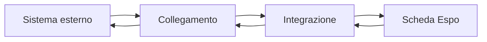
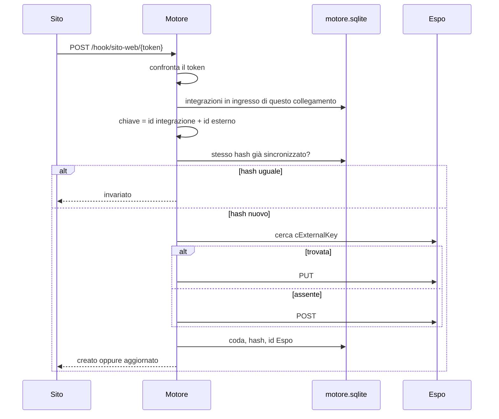
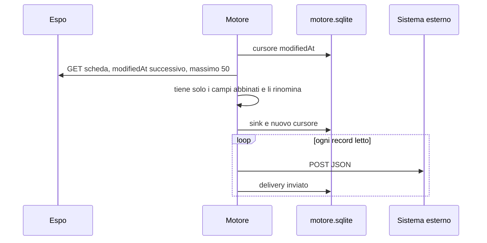

# Prodotto

## A chi serve

Una persona configura, dalla pagina, il passaggio di dati fra un sistema aziendale e EspoCRM. Non scrive una stored procedure, non apre le tabelle del CRM e non prepara un programma per quel sistema. Sceglie il canale, la scheda e l'abbinamento dei campi. Da quel momento lo stesso motore sposta i record.

I sistemi già visti in produzione (sito WordPress, file notturni, anagrafiche, commesse) sono casi di questa forma. L'app non contiene il loro nome nel codice. Contiene la forma.

## I due oggetti

Tutto quello che l'utente crea è uno di questi due oggetti.

**Collegamento.** Il canale fisico verso il sistema esterno.

| Tipo | Verso | Il sistema esterno |
|---|---|---|
| Webhook | entra in Espo | chiama un indirizzo che il motore gli consegna |
| Database | entra in Espo | resta fermo; il motore legge una SELECT |
| File CSV | entra in Espo | deposita un file in una cartella |
| HTTP | esce da Espo | riceve un POST, oppure legge la casella del motore |

**Integrazione.** La regola appesa a un collegamento.

- quale scheda di Espo (Lead, Account, Contact, oppure una scheda custom comparsa nel metadata)
- quale colonna del sistema esterno è l'identità del record
- quale campo esterno finisce in quale campo Espo
- ogni quanto ripetere: a mano, ogni 5 minuti, ogni 15, ogni ora

Un collegamento può avere più integrazioni. Un webhook di un sito può alimentare i Lead e, con una seconda integrazione, i Contatti. Un'integrazione ha al massimo un collegamento.

Il verso non si sceglie a parte nella pagina. Se il collegamento è HTTP, l'integrazione esce da Espo. Negli altri tre casi entra.

## Giro di un record in ingresso

Il caso del lead arrivato dal sito, ridotto ai passi che il codice esegue sempre, qualunque sia la scheda.

La chiave del lead Giulia Costa è `richieste-del-sito-verso-lead:WEB-77`. Un secondo POST identico non richiama Espo. Un POST con la stessa `id` e l'email cambiata fa un PUT sullo stesso record Espo.

## Giro di un record in uscita

Il secondo giro, se in Espo nessuno ha modificato quei lead, esporta zero record. Il cursore è la memoria dell'uscita. L'hash è la memoria dell'ingresso. Sono due meccanismi diversi.

## Che cosa è universale in questa versione

Universale, qui, ha un senso preciso.

1. La scheda non è un elenco fisso nel codice. All'apertura della pagina il motore chiede a Espo l'elenco delle schede con tab e, per ciascuna, i campi scrivibili e i collegamenti many-to-one. Una scheda che non esiste ancora si crea dal modulo dell'integrazione: nome singolare, nome plurale, e i campi scritti nell'abbinamento. Espo le assegna il nome tecnico con il prefisso `C` (`Consegna` diventa `CConsegna`). I campi di quella scheda non ricevono un secondo prefisso.
2. Un abbinamento di tipo collegamento crea, se manca, il lookup verso un'altra scheda. All'ingresso il valore esterno viene cercato su quella scheda (per chiave esterna, per nome, o per un altro campo) e il record nuovo riceve l'id trovato. Se non c'è corrispondenza, la riga non entra.
3. L'abbinamento è un dato salvato in SQLite, non una funzione scritta per un cliente. Aggiungere una colonna vuol dire aggiungere una riga nel modulo.
4. L'identità del record è una convenzione unica per tutte le schede: `{id integrazione}:{valore esterno}`. Sulle schede standard il campo è `cExternalKey`. Sulle schede create da qui è `externalKey`. Due sistemi possono puntare alla stessa scheda senza pestarsi i record, perché la chiave contiene l'id dell'integrazione.
5. I canali coprono il modo in cui un sistema esterno di solito consegna i dati: chiamata, tabella, file, ricezione, e un PDF il cui nome contiene la chiave dell'azienda. Nessuno di questi canali ha dentro il nome di un flusso o di un'anagrafica particolare.

## Che cosa questa versione tiene fisso

- I tipi di canale sono webhook, database, CSV, Excel, SFTP, FTPS, PDF sul cliente e HTTP in uscita. Il database è MySQL, MariaDB, Postgres, SQL Server o Oracle, solo in lettura. Non c'è una coda, non c'è OAuth.
- Il database letto è MySQL o MariaDB, e solo in SELECT.
- Il motore non scrive sul sistema sorgente.
- Se Espo rifiuta un record perché ne esiste uno simile con un'altra chiave, la riga viene scartata, salvo che l'integrazione sia impostata per aggiornare quel record.
- La cadenza ha quattro intervalli: 0, 5, 15, 60 minuti. In più si può indicare un orario fisso, per esempio 02:10.
- Dalla pagina non si modifica un oggetto già creato. Si cancella e si ricrea. L'API, se riceve un id esistente, lo aggiorna.
- Il modulo della pagina salva copia, prima parola, resto del testo, valore fisso e mappa dei valori.

## Che cosa l'app non è

Non contiene anagrafiche, flussi o campi di un cliente. Scrive solo le API di Espo. La fotografia di un backup di produzione resta fuori da questo repo. Questo manuale descrive l'app su http://localhost:8091.
