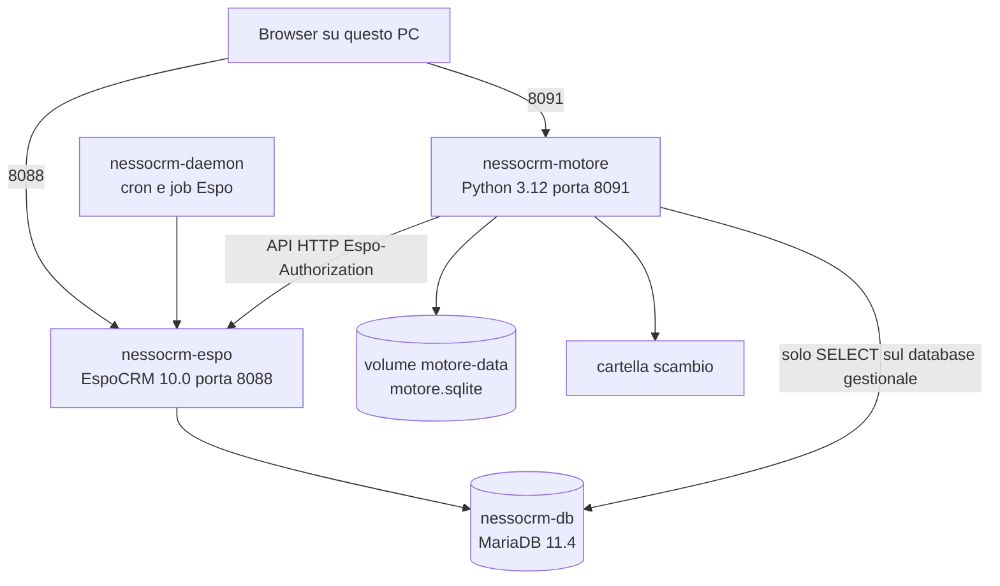

# Architettura

## Pezzi in esecuzione

Quattro contenitori, project Compose `nessocrm`, file `docker-compose.yml`.



Il motore non ha un driver verso le tabelle `account`, `lead`, `contact`. L'unico SQL che rivolge a MariaDB è la SELECT del collegamento di tipo database, contro il database `gestionale` creato per la prova. Espo usa il database `espocrm` sullo stesso server. Sono due schema diversi. Il motore non ha una porta aperta su MariaDB: ci arriva col nome Docker `db`.

L'immagine Espo è `espocrm/espocrm:10.0`. Il backup di produzione è 10.0.8. Il daemon usa la stessa immagine con entrypoint `docker-daemon.sh` e i volumi di Espo. Non è esposto un websocket.

## Processi dentro il motore

`python -u app.py` avvia tre attività.

| Attività | Dove | Compito |
|---|---|---|
| Server HTTP | thread principale, `ThreadingHTTPServer` su `0.0.0.0:8091` | Pagina, API, webhook, inbox |
| Preparazione Espo | thread demone | Attende che Espo risponda, poi crea i campi base |
| Pianificatore | thread demone | Ogni 30 secondi guarda le integrazioni con cadenza |

Il lucchetto è uno per integrazione. «Esegui ora» e il pianificatore lo prendono senza attendere: se quella integrazione è già in corso, la chiamata riceve «un'esecuzione è già in corso». Due integrazioni diverse possono girare insieme. Webhook, inbox, ingest diretto e pull diretto non lo prendono. Un POST del sito può quindi avvenire mentre un giro sul database è aperto.

## Sequenza di avvio

1. `init_db()` crea le tabelle se mancano e aggiunge le colonne nuove se il file SQLite è di una versione precedente.
2. Se `pipeline` è vuota, inserisce le tre integrazioni di seme: modulo web, anagrafica, uscita lead. Su questo PC la tabella non è vuota, quindi il seme non viene più riscritto.
3. Parte il thread che per circa tre minuti (90 tentativi, 2 secondi) chiede `GET /` e poi `GET /api/v1/App/user`. Prima di allora la pagina può aprirsi e `/api/health` dice `espo: in attesa` o `attendo Espo`.
4. A utente riconosciuto, cancella il campo sbagliato `Lead.cCExternalKey` se esiste, e assicura `Lead.externalKey`, `Account.externalKey`, `Account.partitaIva`.
5. Parte il pianificatore.
6. Il server accetta connessioni. Compose fa partire il motore solo dopo che il healthcheck di Espo (`bin/command app-check`, start period 180 secondi) è passato.

## Variabili

| Variabile | Valore in compose | Effetto |
|---|---|---|
| `ESPO_BASE_URL` | `http://espocrm` | Chiamate API, rete Docker |
| `ESPO_PUBLIC_URL` | `http://localhost:8088` | Link «Apri Espo» nella pagina |
| `ESPO_USER` / `ESPO_PASSWORD` | `admin` / `locale-admin` | Header verso Espo |
| `LISTEN_PORT` | `8091` | Ascolto |
| `PUBLIC_BASE_URL` | `http://localhost:8091` | Indirizzi di webhook e casella mostrati all'utente |
| `SCAMBIO_DIR` | `/scambio` | Radice dei CSV |
| `DB_PATH` | default `/data/motore.sqlite` | Stato. Non è nel compose perché il default coincide col volume |

## Header verso Espo

Ogni richiesta del motore porta:

```
Espo-Authorization: Base64( admin:locale-admin )
Content-Type: application/json
Accept: application/json
```

Espo distingue questo header da `Authorization: Basic`. Il timeout è 30 secondi. Un corpo vuoto con stato sotto 400 diventa `None`. Un errore HTTP viene letto come JSON; se il corpo non è JSON, diventa `{"message": "..."}`. Il codice di stato e il corpo tornano al chiamante, che decide.

## Volumi e che cosa un riavvio conserva

| Volume o cartella | Sopravvive a `docker compose restart` | Si perde con `docker compose down -v` |
|---|---|---|
| `db` | Espo e il database `gestionale` | sì |
| `espo-data`, `espo-custom`, `espo-client` | installazione, campi custom, record | sì |
| `motore-data` | collegamenti, integrazioni, code, cursori | sì |
| `scambio` | file CSV, è una cartella dell'host | no, non è un volume Docker |

Il codice dell'app è dentro l'immagine. Una modifica a `app.py` o `index.html` compare solo dopo `docker compose up -d --build motore`. Lo stato in `motore.sqlite` non viene ricostruito dal build.

## Confine con il backup

Compose non monta `01-espocrm-database`, `02-espocrm-file`, `03-dwh-database`, `04-server-config`. Non c'è uno script di restore. I record dentro Espo locale nascono dalle API durante la prova.
