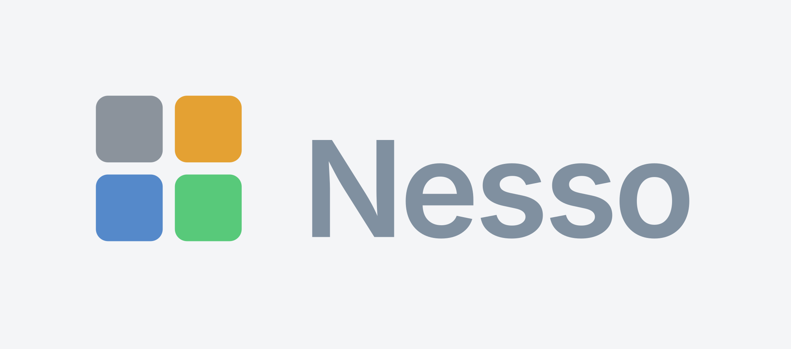

# Marchio

Il marchio di Nesso è quello già nel menu dell'app: quattro quadrati con lo stesso passo, gli angoli arrotondati e i quattro colori del tema Espo usato dall'interfaccia. Il nome «Nesso» è Inter SemiBold, il carattere dell'app. La licenza del carattere è in `motore/fonts/LICENSE.txt`.

{ width="360" }

I file stanno in `assets/logo`. L'SVG è il master, senza dipendere da un carattere installato: il nome è disegnato come tracciato. PNG e JPG hanno il lato lungo di 4096 pixel. Il JPG non ha trasparenza: le versioni trasparenti sono appoggiate su fondo chiaro, tranne il marchio in negativo che sta su fondo scuro.

| File | Che cosa è |
|---|---|
| `marchio` | I quattro quadrati, fondo trasparente |
| `marchio-mono` | Gli stessi quadrati, tutti `#262626` |
| `marchio-negativo` | Gli stessi quadrati, tutti `#FEFEFE` |
| `lockup` | Marchio e nome sulla stessa riga, come nel menu |
| `lockup-verticale` | Marchio sopra, nome sotto, centrato |
| `wordmark` | Solo il nome, colore `#8090A0` |
| `*-su-chiaro` | La stessa salsa su `#F4F5F7`, il fondo del menu |
| `*-su-scuro` | La stessa salsa su `#262626`. Il nome diventa `#F4F5F7` |

Ogni riga esiste in `.svg`, `.png` e `.jpg`.

Colori del marchio, dall'alto a sinistra: `#8B939C`, `#E4A133`, `#5589CA`, `#58C97A`.

Per rifare i file dopo un cambiamento del marchio:

```text
py -3 scripts/build_logo.py
```

Il menu dell'app incorpora il marchio in piccolo. La geometria è la stessa: tela 26, margine 1, quadrato 11, distanza 2, raggio 2.
