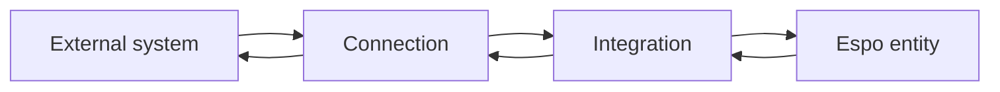
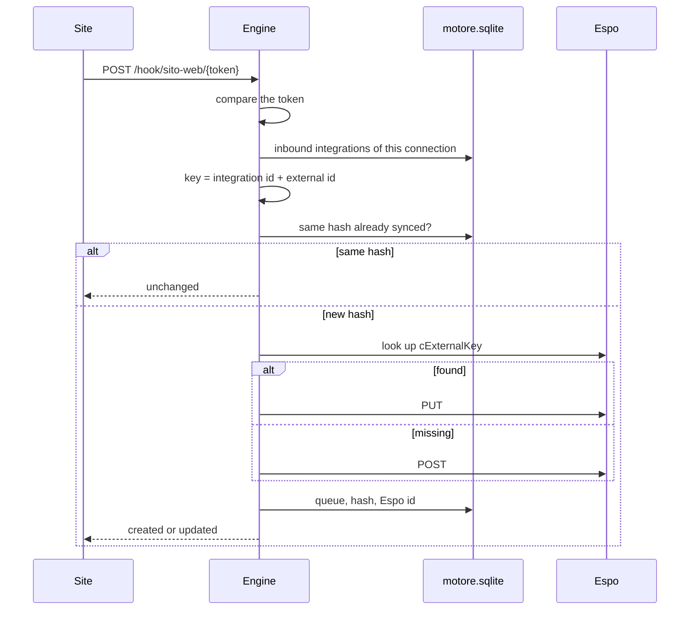
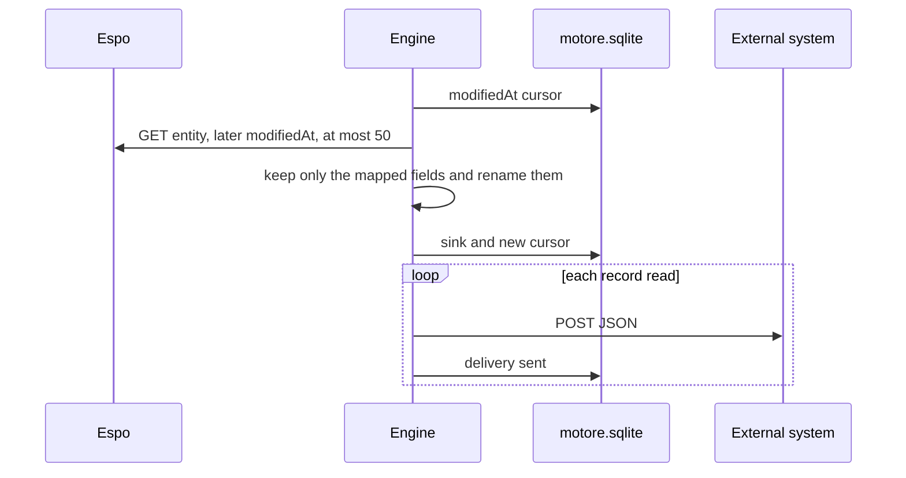

# Product

## Who it is for

A person configures, from the page, the passage of data between a company system and EspoCRM. They do not write a stored procedure, do not open the CRM tables and do not prepare a program for that system. They choose the channel, the entity and the field mapping. From then on the same engine moves the records.

Systems already seen in production (a WordPress site, night files, customer masters, jobs) are cases of this shape. The app does not contain their name in the code. It contains the shape.

## The two objects

Everything the user creates is one of these two objects.

**Connection.** The physical channel to the external system.

| Type | Direction | The external system |
|---|---|---|
| Webhook | into Espo | calls an address the engine gives it |
| Database | into Espo | stays still; the engine reads a SELECT |
| CSV file | into Espo | drops a file in a folder |
| HTTP | out of Espo | receives a POST, or reads the engine inbox |

**Integration.** The rule attached to a connection.

- which Espo entity (Lead, Account, Contact, or a custom entity that appeared in the metadata)
- which column of the external system is the record identity
- which external field lands in which Espo field
- how often to repeat: by hand, every 5 minutes, every 15, every hour

A connection can have several integrations. A site webhook can feed Leads and, with a second integration, Contacts. An integration has at most one connection.

The direction is not chosen separately on the page. If the connection is HTTP, the integration leaves Espo. In the other three cases it enters.

## One inbound record

The case of a lead arriving from the site, reduced to the steps the code always runs, whatever the entity.

Giulia Costa's lead key is `richieste-del-sito-verso-lead:WEB-77`. A second identical POST does not call Espo. A POST with the same `id` and a changed email does a PUT on the same Espo record.

## One outbound record

The second run, if nobody in Espo has changed those leads, exports zero records. The cursor is the memory of the outbound side. The hash is the memory of the inbound side. They are two different mechanisms.

## What is universal in this version

Universal, here, has a precise meaning.

1. The entity is not a fixed list in the code. When the page opens, the engine asks Espo for the entities that have a tab and, for each, the writable fields and the many-to-one links. An entity that does not exist yet is created from the integration form: singular name, plural name, and the fields written in the mapping. Espo assigns the technical name with the prefix `C` (`Consegna` becomes `CConsegna`). The fields of that entity do not get a second prefix.
2. A link mapping creates, if it is missing, the lookup toward another entity. On the way in, the external value is looked up on that entity (by external key, by name, or by another field) and the new record receives the id that was found. If there is no match, the row does not enter.
3. The mapping is data saved in SQLite, not a function written for one customer. Adding a column means adding a row in the form.
4. The record identity is one convention for every entity: `{integration id}:{external value}`. On standard entities the field is `cExternalKey`. On entities created from here it is `externalKey`. Two systems can point at the same entity without colliding, because the key contains the integration id.
5. The channels cover the way an external system usually delivers data: a call, a table, a file, a reception, and a PDF whose name contains the company key. None of these channels contains the name of a particular flow or master.

## What this version keeps fixed

- The channel types are webhook, database, CSV, Excel, SFTP, FTPS, PDF on the customer, document and outbound HTTP. The database is MySQL, MariaDB, Postgres, SQL Server or Oracle. The read is a SELECT. Write-back is off until it is switched on, and then it touches only the named fields. There is no retry queue. Outbound OAuth exists, as client credentials, and only if it is chosen on the connection.
- The database is read only with SELECT. Without TLS and without a tunnel, MySQL and MariaDB stay the connection from before.
- On the source system the engine does not write, until write-back for that integration is switched on.
- If Espo refuses a record because a similar one exists with another key, the row is rejected, unless the integration is set to update that record.
- The cadence has four intervals: 0, 5, 15, 60 minutes. A fixed time can also be set, for example 02:10.
- From the page an object that already exists is not edited. It is deleted and created again. The API, if it receives an existing id, updates it.
- The page form saves copy, first word, rest of the text, fixed value and value map.

## What the app is not

It does not contain a customer's masters, flows or fields. It writes only the Espo APIs. A photograph of a production backup stays outside this repo. This manual describes the app at http://localhost:8091.
