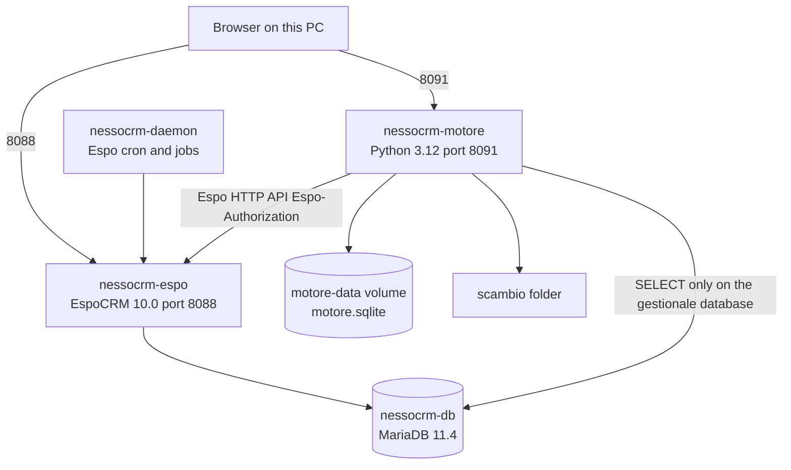

# Architecture

## Running pieces

Four containers, Compose project `nessocrm`, file `docker-compose.yml`.



The engine has no driver toward the `account`, `lead` or `contact` tables. The only SQL it sends to MariaDB is the SELECT of a database connection, against the `gestionale` database created for the trial. Espo uses the `espocrm` database on the same server. They are two different schemas. The engine has no open port on MariaDB: it reaches it by the Docker name `db`.

The Espo image is `espocrm/espocrm:10.0`. The production backup is 10.0.8. The daemon uses the same image with entrypoint `docker-daemon.sh` and the Espo volumes. No websocket is exposed.

## Processes inside the engine

`python -u app.py` starts three activities.

| Activity | Where | Job |
|---|---|---|
| HTTP server | main thread, `ThreadingHTTPServer` on `0.0.0.0:8091` | Page, API, webhook, inbox |
| Espo preparation | daemon thread | Waits until Espo answers, then creates the base fields |
| Scheduler | daemon thread | Every 30 seconds looks at integrations that have a cadence |

The lock is one per integration. "Run now" and the scheduler take it without waiting: if that integration is already running, the call receives "a run is already in progress". Two different integrations can run together. Webhook, inbox, direct ingest and direct pull do not take it. A site POST can therefore happen while a database run is open.

## Startup sequence

1. `init_db()` creates the tables if they are missing and adds the new columns if the SQLite file is from a previous version.
2. If `pipeline` is empty, it inserts the three seed integrations: web form, customer master, lead outbound. On this PC the table is not empty, so the seed is not written again.
3. A thread starts that for about three minutes (90 attempts, 2 seconds) asks `GET /` and then `GET /api/v1/App/user`. Before that the page can open and `/api/health` says `espo: in attesa` or `attendo Espo`.
4. Once the user is recognised, it deletes the wrong field `Lead.cCExternalKey` if it exists, and ensures `Lead.externalKey`, `Account.externalKey`, `Account.partitaIva`.
5. The scheduler starts.
6. The server accepts connections. Compose starts the engine only after the Espo healthcheck (`bin/command app-check`, start period 180 seconds) has passed.

## Variables

| Variable | Value in compose | Effect |
|---|---|---|
| `ESPO_BASE_URL` | `http://espocrm` | API calls, Docker network |
| `ESPO_PUBLIC_URL` | `http://localhost:8088` | "Open Espo" link on the page |
| `ESPO_USER` / `ESPO_PASSWORD` | `admin` / `locale-admin` | Header toward Espo |
| `LISTEN_PORT` | `8091` | Listen port |
| `PUBLIC_BASE_URL` | `http://localhost:8091` | Webhook and inbox addresses shown to the user |
| `SCAMBIO_DIR` | `/scambio` | CSV root |
| `DB_PATH` | default `/data/motore.sqlite` | State. It is not in compose because the default matches the volume |

## Header toward Espo

Every request from the engine carries:

```
Espo-Authorization: Base64( admin:locale-admin )
Content-Type: application/json
Accept: application/json
```

Espo distinguishes this header from `Authorization: Basic`. The timeout is 30 seconds. An empty body with a status under 400 becomes `None`. An HTTP error is read as JSON; if the body is not JSON, it becomes `{"message": "..."}`. The status code and the body return to the caller, which decides.

## Volumes and what a restart keeps

| Volume or folder | Survives `docker compose restart` | Lost with `docker compose down -v` |
|---|---|---|
| `db` | Espo and the `gestionale` database | yes |
| `espo-data`, `espo-custom`, `espo-client` | installation, custom fields, records | yes |
| `motore-data` | connections, integrations, queues, cursors | yes |
| `scambio` | CSV files, it is a host folder | no, it is not a Docker volume |

The app code is inside the image. A change to `app.py` or `index.html` appears only after `docker compose up -d --build motore`. The state in `motore.sqlite` is not rebuilt by the build.

## Boundary with the backup

Compose does not mount `01-espocrm-database`, `02-espocrm-file`, `03-dwh-database`, `04-server-config`. There is no restore script. Records inside local Espo are born from the APIs during the trial.
